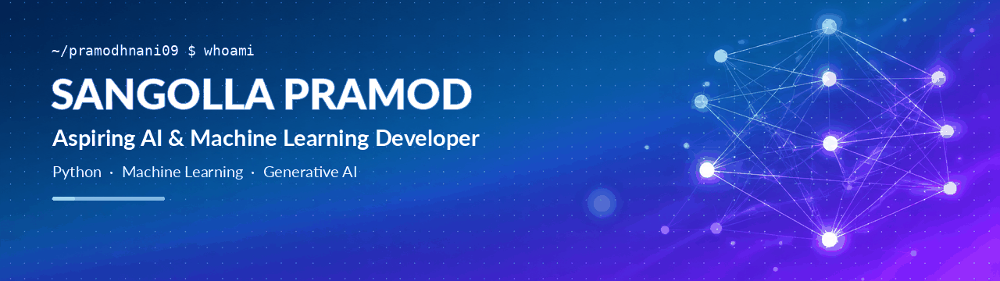
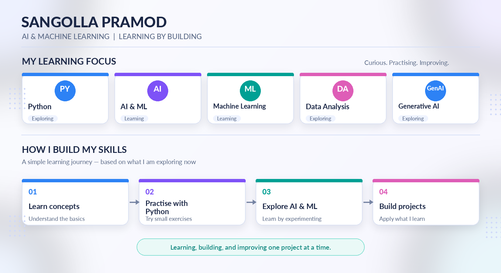
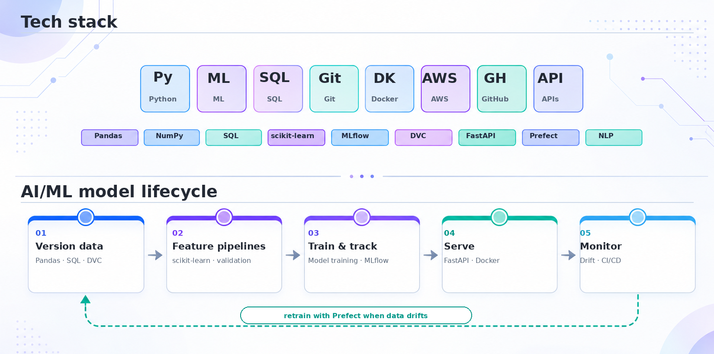

  

---

  

## 👨‍💻 About Me

- 🎯 Interested in Artificial Intelligence and Machine Learning.
- 🐍 Exploring Python and data analysis.
- 🤖 Learning Machine Learning and Generative AI.
- 🚀 Building projects to solve practical problems.
- 📚 Focused on continuous learning and improving my skills.

## 🛠️ Technologies & Tools

## 📊 GitHub Statistics

## 📫 Connect With Me

- GitHub: [@Pramodhnani09](https://github.com/Pramodhnani09)
- LinkedIn:www.linkedin.com/in/sangolla-pramod-28317a25a

---

*Learning, building, and growing in AI and Machine Learning.* 🚀

